# Session 21 - LabTrack DevOps capstone

LabTrack is my final course project. I built it as a small journal for planning and recording hands-on DevOps labs. It is a different application domain from the instructor's reference project while using the same DevOps ideas taught in the course.

The React interface talks to a FastAPI REST API. PostgreSQL stores the labs, and the API exposes health checks and Prometheus metrics. I can run the full application with Docker Compose or package it for Kubernetes with Helm.

## What the application does

A lab has a title, objective, tool, difficulty, owner, and status. The available tools are Docker, Kubernetes, Terraform, CI/CD, and Monitoring. From the interface I can:

- add a new lab;
- view and filter labs;
- move a lab through PLANNED, RUNNING, and COMPLETED;
- delete a lab;
- see live counts from PostgreSQL.

The same operations are available through Swagger at http://localhost:8000/docs.

## Architecture

~~~text
Developer -> GitHub Actions -> tests -> security scans -> container images -> GHCR
                                                                    |
                                                                    v
Browser -> Nginx frontend -> FastAPI backend -> PostgreSQL       Kubernetes
                              |                                     |
                              +-> /metrics -> Prometheus -> Grafana  +-> Ingress + HPA
~~~

## Project layout

| Path | Purpose |
|---|---|
| [frontend/](frontend/) | React/Vite interface and non-root Nginx image |
| [backend/](backend/) | FastAPI, SQLAlchemy, Alembic, PostgreSQL, and pytest |
| [docker-compose.yml](docker-compose.yml) | Local frontend, backend, and database |
| [helm/labtrack/](helm/labtrack/) | Deployments, Services, Ingress, HPA, probes, ConfigMap, Secret, and PVC |
| [terraform/](terraform/) | AWS VPC, public/private subnets, EKS, and managed nodes |
| [monitoring/](monitoring/) | Prometheus and provisioned Grafana dashboard |
| [gitops/](gitops/) | Argo CD Application for the Helm release |
| [troubleshooting/](troubleshooting/) | Broken image and broken Service exercises |

## 1. Backend tests

The test database is SQLite, so the tests are isolated from the development PostgreSQL database. Eight tests cover health, readiness, create, list, get, update, delete, validation, and statistics.

~~~bash
cd session21-final-devops-project/backend
python3 -m venv .venv
source .venv/bin/activate
pip install -r requirements.txt
pytest -v
~~~

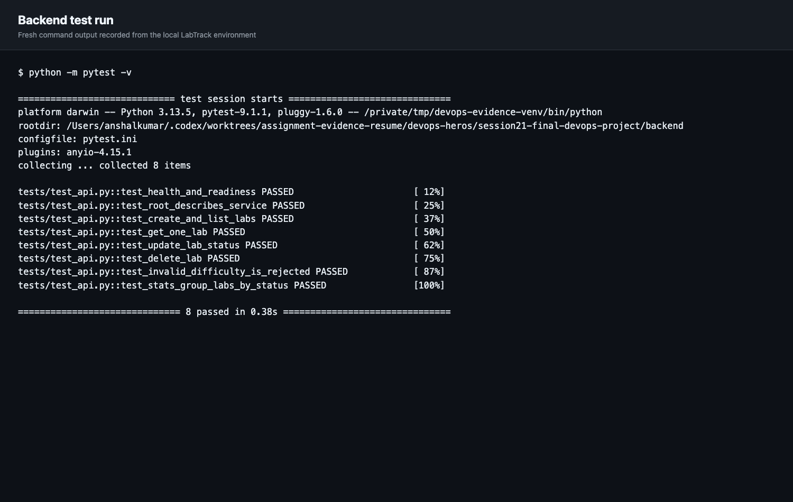

## 2. Run the application locally

~~~bash
cd session21-final-devops-project
docker compose up --build -d
docker compose ps
curl -fsS http://localhost:8000/health
curl -fsS http://localhost:8000/ready
~~~

Open:

- application: http://localhost:3000
- Swagger: http://localhost:8000/docs
- metrics: http://localhost:8000/metrics

This is the final LabTrack interface connected to the running API and database.

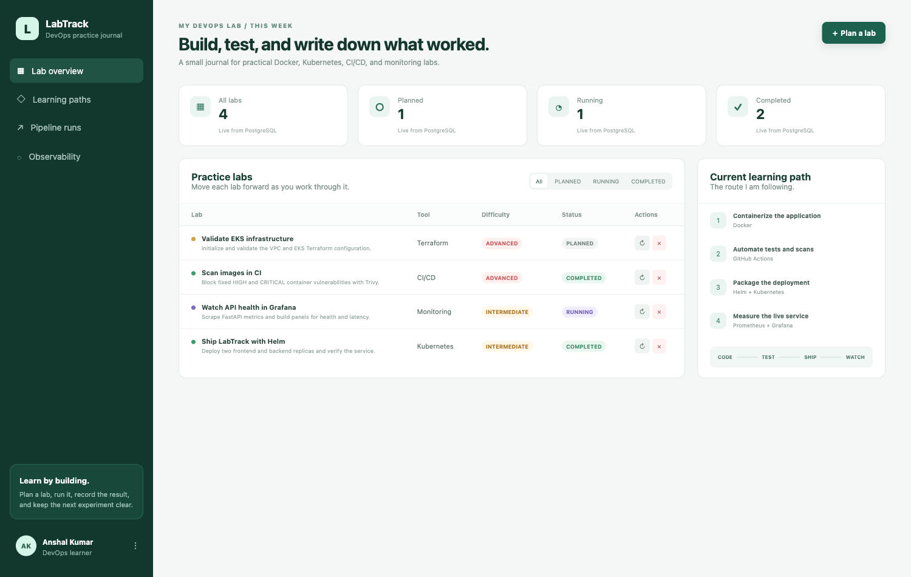

Swagger shows the CRUD endpoints under /api/labs.

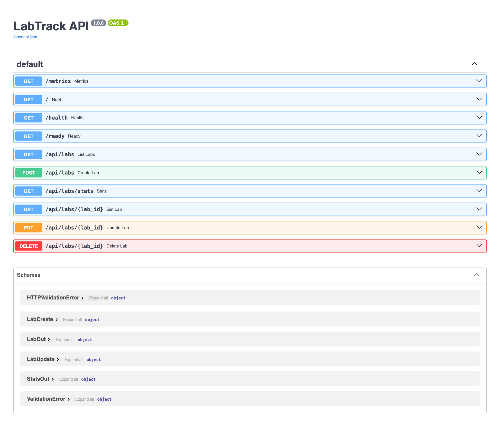

I checked the saved rows directly in PostgreSQL:

~~~bash
docker compose exec postgres psql -U labtrack -d labtrack \
  -c "select id,title,tool,difficulty,status,owner from labs order by id;"
~~~

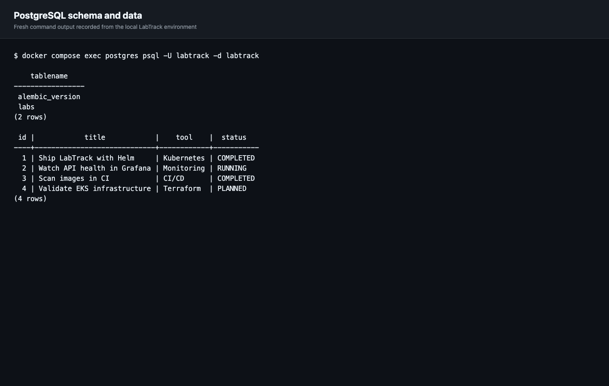

## 3. Container checks

The backend image uses UID 10001. The frontend is a multi-stage build and serves the compiled React files with the unprivileged Nginx image as UID 101.

~~~bash
docker image inspect labtrack-backend --format '{{.Config.User}}'
docker image inspect labtrack-frontend --format '{{.Config.User}}'
docker compose ps
~~~

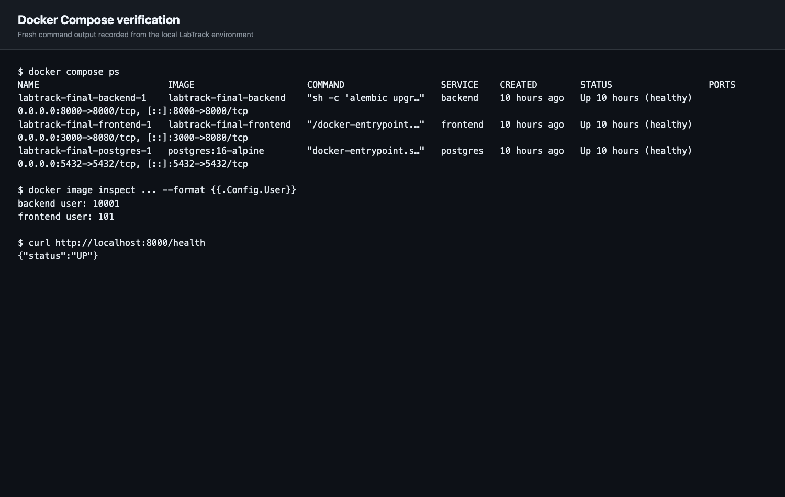

## 4. Git and GitHub

I kept the project in a public GitHub repository and used short commit messages that describe the work done. The repository history contains more than ten commits, and the project `.gitignore` excludes environment files, virtual environments, Python caches, Node modules, Terraform state, and local build output.

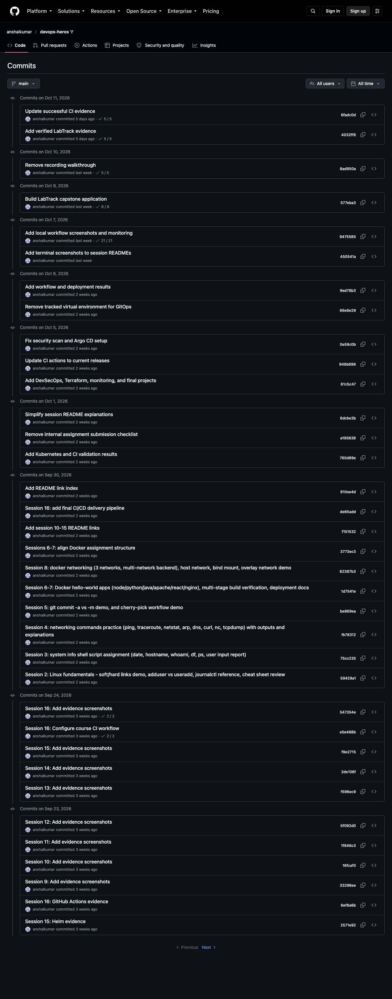

## 5. CI/CD and security

The Session 21 workflow:

1. runs the eight backend tests;
2. builds the React frontend;
3. runs Bandit, pip-audit, and Gitleaks;
4. lints and renders the Helm chart;
5. builds both container images and confirms their non-root users;
6. scans both images with Trivy and fails on fixed HIGH or CRITICAL findings;
7. pushes immutable commit-SHA tags and latest tags to GHCR;
8. deploys to a temporary Kind cluster and runs an HTTP smoke test.

The workflow file is [.github/workflows/session21-final-project.yml](../.github/workflows/session21-final-project.yml).

The completed run is available in [GitHub Actions](https://github.com/anshalkumar/devops-heros/actions/runs/38128550644). All five jobs passed, including the image scan and the temporary Kind deployment.

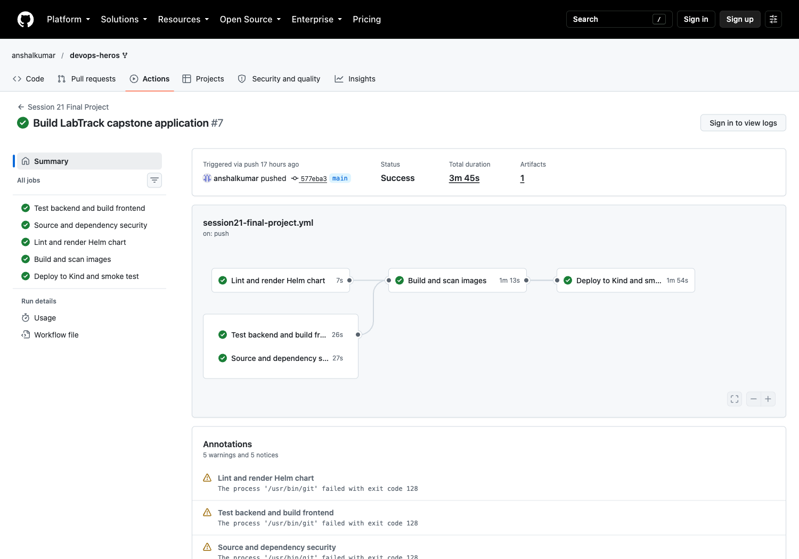

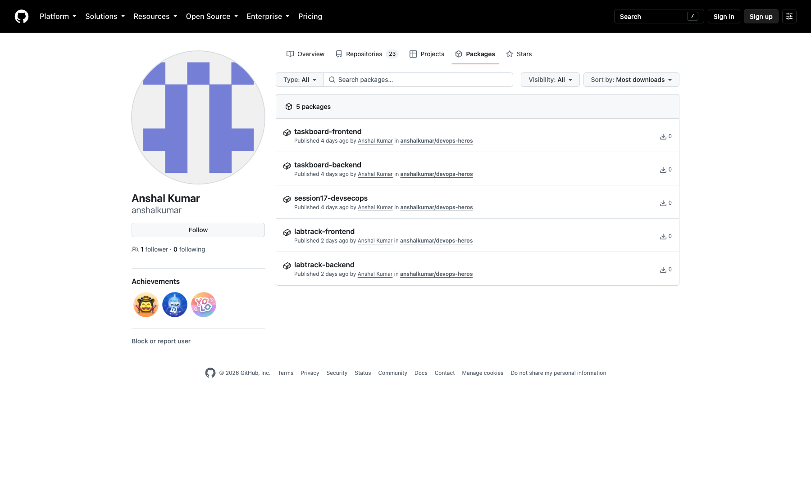

Both published images can also be checked on the [GitHub Packages page](https://github.com/anshalkumar?tab=packages).

Trivy scanned both final container images for HIGH and CRITICAL operating-system and package vulnerabilities. The scan ignores vulnerabilities without an available fix and exits with code 1 when it finds a fixable serious issue, so an unsafe image cannot be published silently.

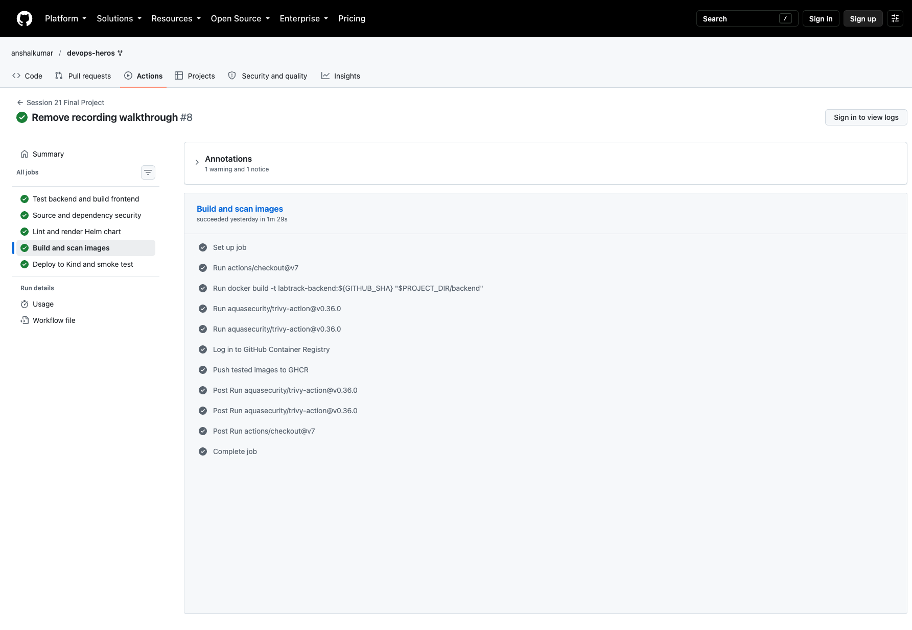

The successful [workflow run](https://github.com/anshalkumar/devops-heros/actions/runs/38128550644) shows both Trivy steps and the GHCR push.

## 6. Kubernetes and Helm

The chart creates two frontend replicas, two backend replicas, PostgreSQL, ClusterIP Services, probes, resource limits, an optional Ingress, and an HPA.

~~~bash
helm lint helm/labtrack

helm upgrade --install labtrack helm/labtrack \
  --namespace labtrack --create-namespace \
  -f helm/labtrack/values-dev.yaml

kubectl rollout status deployment/labtrack-labtrack-backend -n labtrack
kubectl rollout status deployment/labtrack-frontend -n labtrack
kubectl get pods,svc,ingress,pvc,hpa -n labtrack
helm list -n labtrack
~~~

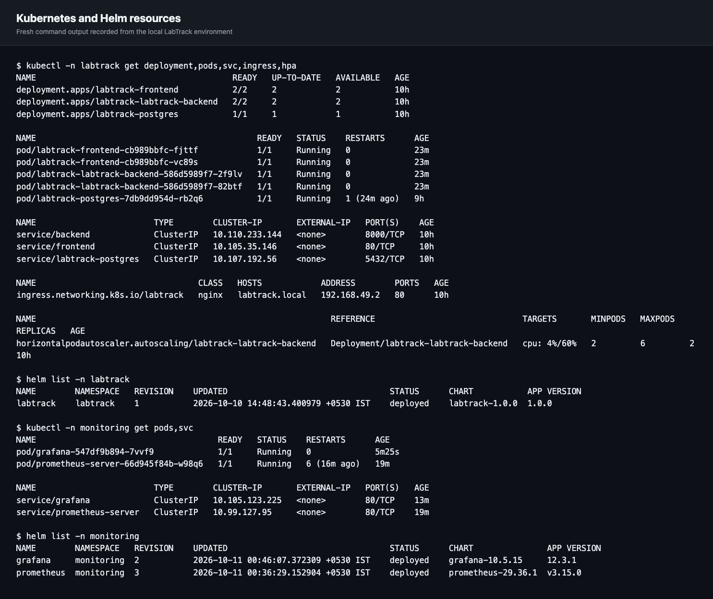

For local browser access without changing DNS:

~~~bash
kubectl port-forward service/frontend -n labtrack 8080:80
~~~

Then open http://localhost:8080.

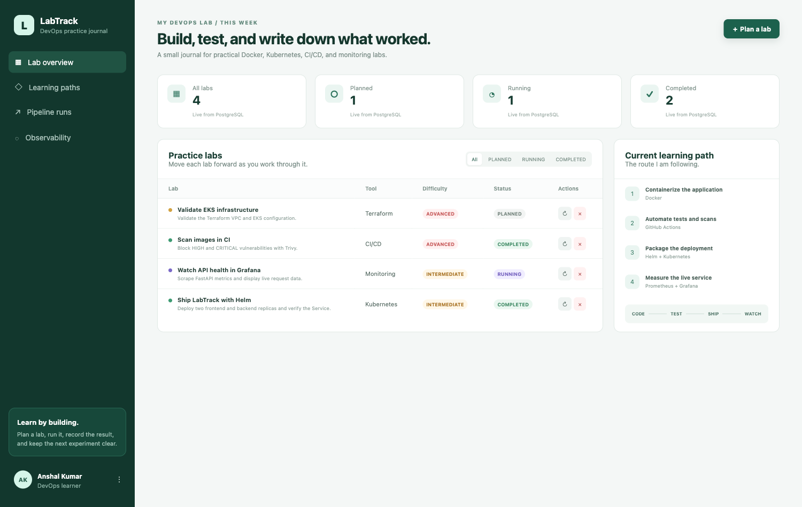

## 7. Monitoring

FastAPI exports Prometheus metrics at /metrics. The chart includes a ServiceMonitor for kube-prometheus-stack. I used the official Prometheus and Grafana Helm charts for the local Minikube demonstration. The smaller values files keep the setup light enough for a laptop.

~~~bash
helm repo add prometheus-community https://prometheus-community.github.io/helm-charts
helm repo add grafana https://grafana.github.io/helm-charts
helm repo update

helm upgrade --install prometheus prometheus-community/prometheus \
  --namespace monitoring --create-namespace \
  -f monitoring/prometheus-lite-values.yaml

helm upgrade --install grafana grafana/grafana \
  --namespace monitoring \
  -f monitoring/grafana-lite-values.yaml \
  --set-file dashboards.default.labtrack.json=monitoring/dashboards/labtrack.json

kubectl port-forward service/prometheus-server -n monitoring 9092:80
kubectl port-forward service/grafana -n monitoring 3002:80
~~~

Prometheus scrapes the backend Service inside Kubernetes every five seconds. Grafana loads the Prometheus data source and the LabTrack dashboard from this repository. I generated requests against the application before taking the dashboard screenshot so every panel contains real data.

The backend itself returns Prometheus text data from `/metrics`, including process metrics and the `http_requests_total` counter.

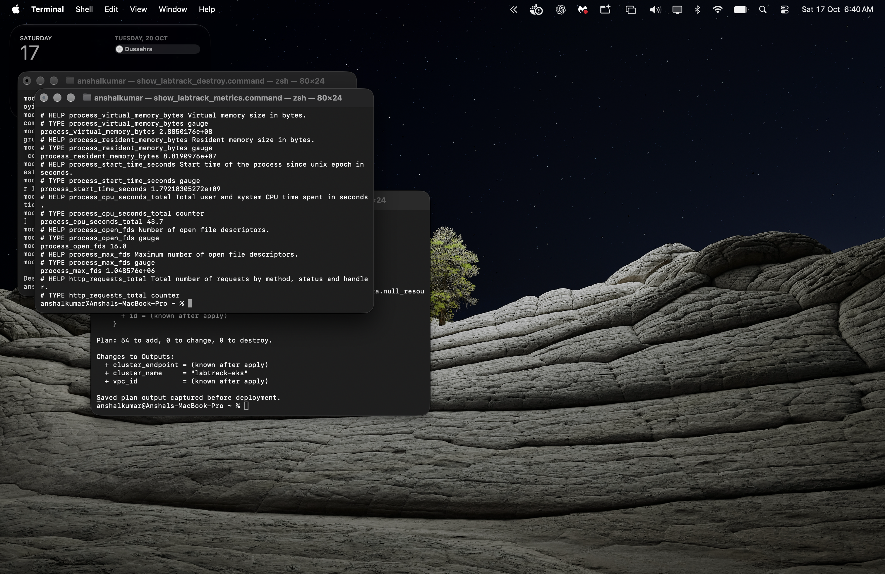

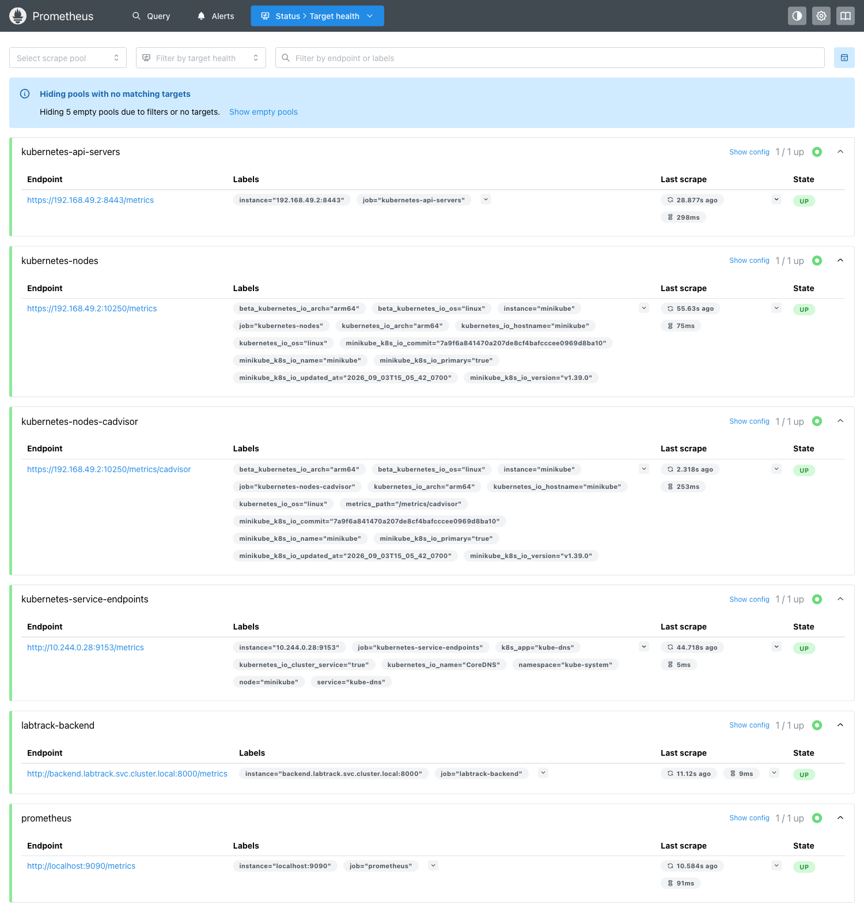

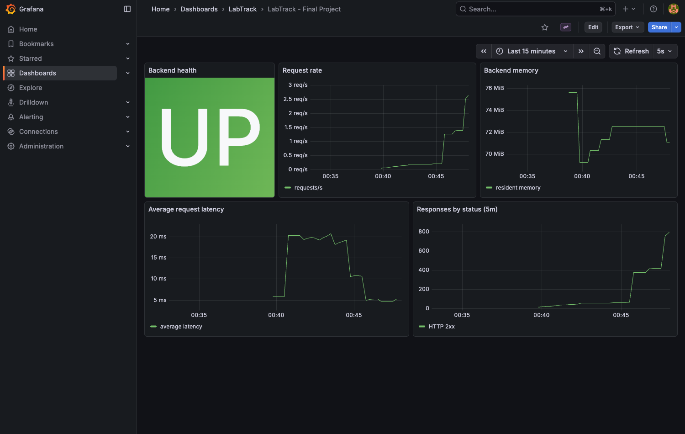

## 8. Troubleshooting

The two files under [troubleshooting/](troubleshooting/) reproduce common failures:

- broken-image.yaml produces ImagePullBackOff because the image tag does not exist;
- broken-service.yaml creates an empty EndpointSlice because its selector matches no Pod.

I first inspect the status, events, labels, and EndpointSlices, then correct the image or selector and repeat the request.

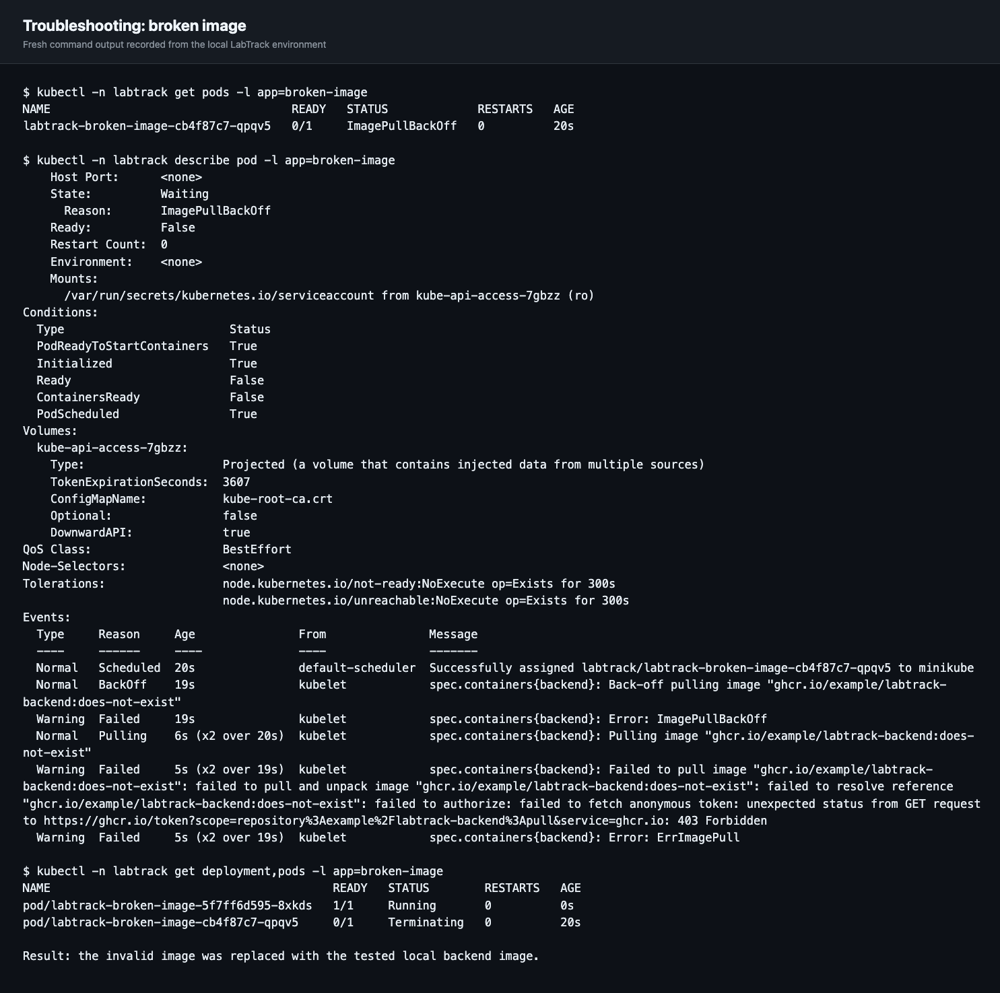

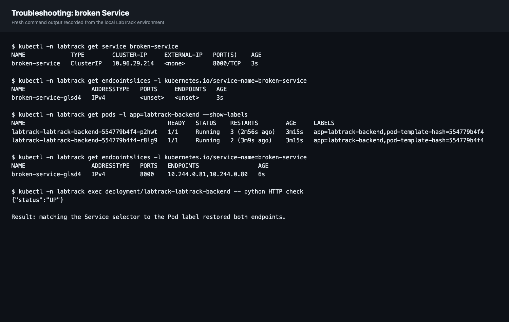

## 9. Terraform

The Terraform code defines an AWS VPC across two Availability Zones, two public subnets, two private subnets, a NAT gateway, EKS, and a managed node group.

~~~bash
cd terraform
terraform init
terraform fmt -check
terraform validate
terraform plan -out=labtrack.tfplan
terraform apply labtrack.tfplan
aws eks update-kubeconfig --region ap-southeast-2 --name labtrack-eks
kubectl get nodes
terraform destroy -auto-approve
~~~

[terraform.tfvars.example](terraform/terraform.tfvars.example) documents the inputs without storing credentials.

I ran this in the `ap-southeast-2` region using the AWS free-plan credits. The saved plan contained 54 resources. Terraform then created the VPC, four subnets, NAT gateway, EKS control plane, and a managed node group with two `t3.small` workers. Both worker nodes reached Ready state.

The new AWS account experience blocks creation of an IAM OpenID Connect provider, so IRSA is disabled in this classroom configuration. I also used `t3.small` because the account marked that size as eligible. Neither change stores credentials in the repository.

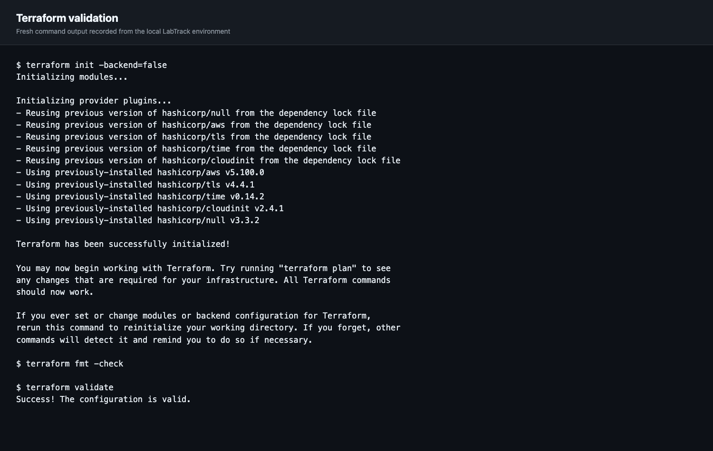

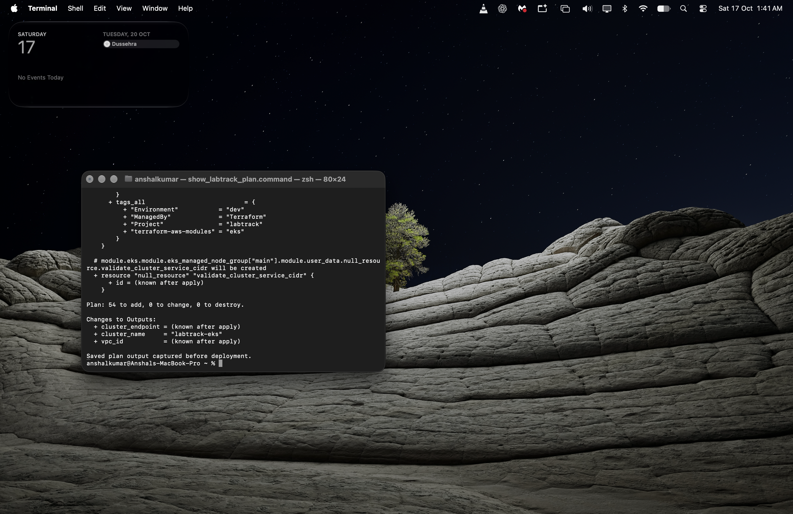

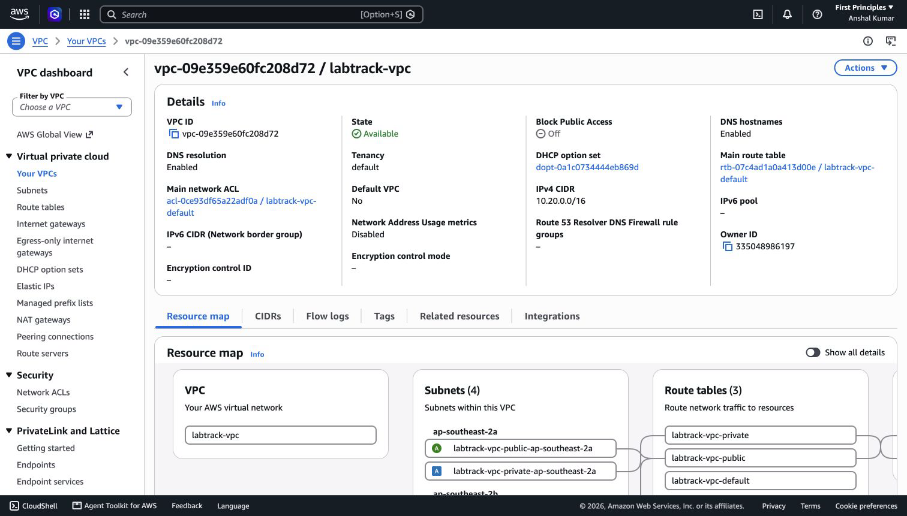

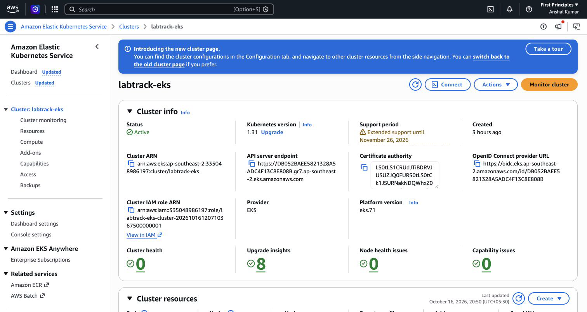

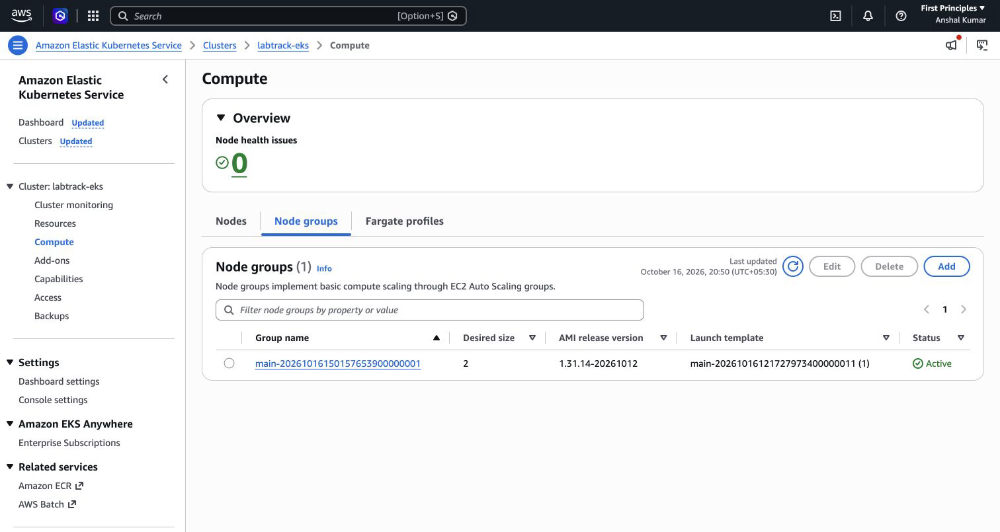

After checking the cluster, I ran `terraform destroy`. Terraform removed all 53 resources in state. I verified afterward that Terraform state was empty and that AWS returned no LabTrack EKS cluster, VPC, or active NAT gateway.

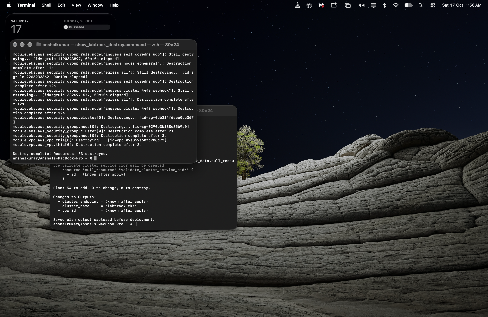

## 10. GitOps

[gitops/application.yaml](gitops/application.yaml) is an Argo CD Application that watches the LabTrack Helm chart on main. Automated pruning and self-healing are enabled. This lets Git remain the desired state for the cluster.

## Technologies used

- React, Vite, and Nginx for the frontend
- FastAPI, SQLAlchemy, Alembic, Pytest, and PostgreSQL for the backend
- Docker and Docker Compose for local containers
- GitHub Actions, GHCR, Bandit, pip-audit, Gitleaks, and Trivy for delivery and security
- Kubernetes, Helm, Ingress, HPA, and Argo CD for deployment
- Prometheus and Grafana for monitoring
- Terraform, AWS VPC, and Amazon EKS for cloud infrastructure

## What I learned

The biggest lesson was that each stage needs a clear check before the next one starts. Tests and scans should stop a bad image before it is published, readiness probes should keep traffic away from an unavailable application, and monitoring should confirm what the service is doing after deployment. I also saw why infrastructure cleanup is part of the task: checking an AWS deployment is not finished until `terraform destroy` succeeds and the account is checked for resources that could keep using credits.

## Result

The application, CRUD API, tests, containers, Git history, CI and security checks, GHCR images, Helm deployment, HPA, monitoring, GitOps manifest, troubleshooting labs, and real AWS Terraform deployment were completed. The AWS infrastructure was destroyed after verification so it does not continue using credits.
